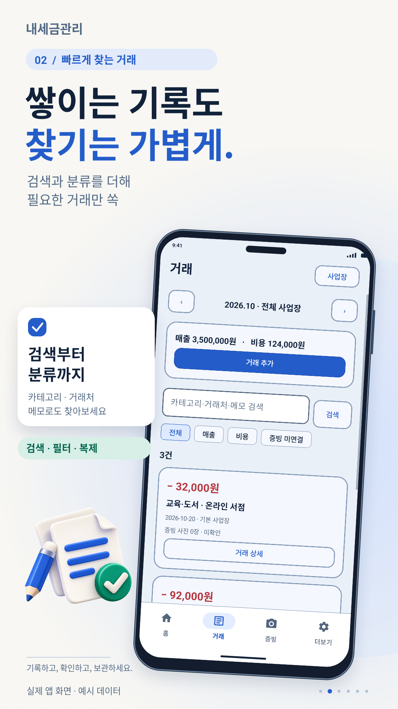
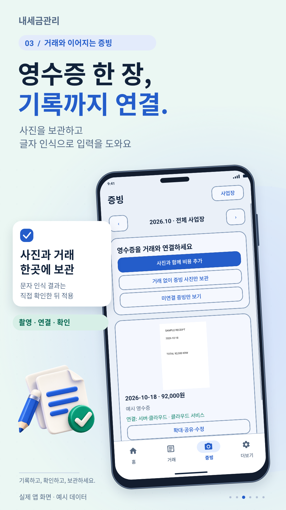
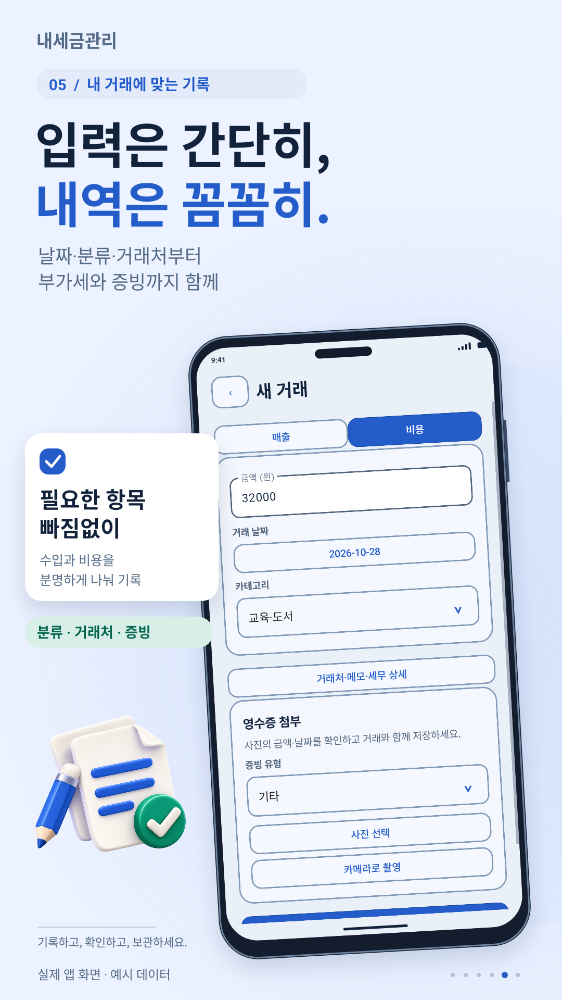
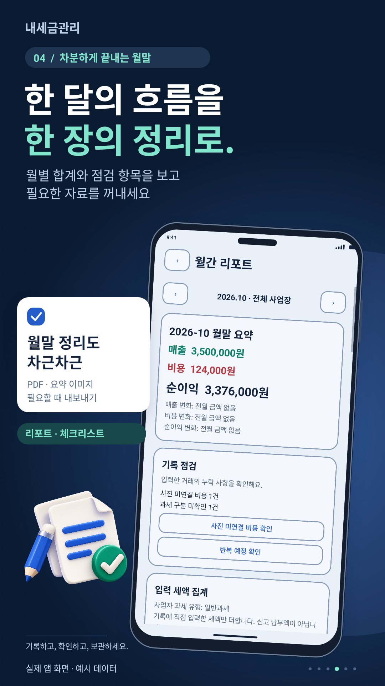
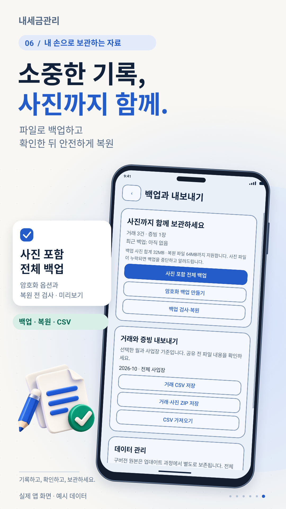

# 내세금관리 · My Tax Manager

**개인사업자와 프리랜서를 위한 Android 매출·비용·영수증 관리 앱**

매일의 거래를 기록하고, 영수증 사진을 연결하고, 월별 흐름을 확인하고, 필요한 자료를 내보내는 앱입니다. 이 저장소는 직접 개발·출시한 **내세금관리**의 기능과 화면, 첫 수익 이후의 개편 과정, 공개 가능한 UI 코드와 학습용 예제를 소개합니다.

**[Google Play에서 보기](https://play.google.com/store/apps/details?id=com.twentyfive_tax)** · [기술 설명](docs/technical-overview.md) · [UI 개선 전후](docs/ui-case-study.md) · [개편 기록](docs/renewal-notes.md)

> **My Tax Manager**는 ‘내세금관리’를 영어로 풀어 쓴 이 포트폴리오의 이름입니다. 저장소 이름은 `my-tax-manager`이며, 스토어의 언어별 표시 이름과 다를 수 있습니다.

## 첫 수익이 다시 개발하게 만든 계기

예전에 만들어 출시한 앱에서 처음으로 수익이 발생한 것을 확인했습니다. 누군가 실제로 돈을 내고 제가 만든 앱을 선택했다는 사실이, 다시 앱을 열어 보고 개선하게 된 계기였습니다.

다시 보니 배경과 구분하기 어려운 버튼과 카드, 입력 동선, 영수증 정리와 자료 보관 과정에 보완할 부분이 있었습니다. 그래서 **입력 → 확인 → 증빙 연결 → 보고서 → 백업**까지 점검했습니다. 첫 판매 이후에도 제품을 유지하고 개선한 과정을 남기고자 합니다.

## 앱 화면

아래 6장은 실제 앱 화면을 바탕으로 만든 소개 이미지입니다. 화면 속 거래·금액·영수증은 **시연용 예시 데이터**입니다. 2026년 10월 개편 당시 화면이며, 이후 선택 목록의 색상 개선은 [UI 개선 기록](docs/ui-case-study.md)에서 별도로 볼 수 있습니다.

<table>
  <tr>
    <td align="center"> <b>월별 흐름</b></td>
    <td align="center"> <b>거래 기록</b></td>
    <td align="center"> <b>증빙 관리</b></td>
  </tr>
  <tr>
    <td align="center"> <b>빠른 입력</b></td>
    <td align="center"> <b>월말 정리</b></td>
    <td align="center"> <b>자료 보관</b></td>
  </tr>
</table>

## 주요 기능

| 영역 | 사용자가 할 수 있는 일 |
|---|---|
| 홈 | 월별·사업장별 매출, 비용, 입력 기록 기준 순이익 확인 |
| 거래 | 매출·비용 입력, 카테고리·증빙 유형 지정, 검색·필터·복제 |
| 영수증 | 촬영·사진 보관, 거래 연결, 미연결 증빙 확인, 기기 내 문자 인식 후 확인·적용 |
| 보고서 | 월별 기록 요약, PDF·이미지 등 자료 내보내기 |
| 데이터 | CSV 열 연결·가져오기·내보내기, 사진 포함 백업, 선택적 암호화, 복원 전 검사·미리보기 |
| 편의 기능 | 반복 예정 기록, 라이트·다크 테마, 앱 잠금, 빠른 입력 위젯·알림 설정 |

세금 관련 숫자는 사용자 기록과 설정에 따른 참고용이며, 자동 세무 신고나 확정 세액 판정을 제공하는 앱은 아닙니다.

## 개편에서 해결한 문제

| 문제 | 해결 방향 | 확인한 항목 |
|---|---|---|
| 카드·버튼이 배경에 묻힘 | 테두리와 면 색 대비, 선택 상태 정리 | 라이트·다크·큰 글꼴 |
| 선택 목록에 기본 테마 색이 남음 | 선택창 전용 밝은 Context와 행·팝업 배경 지정 | 흰 배경, 진한 글자, 선택 값 유지 |
| 흰 날짜창의 확인 글씨가 안 보임 | 창 표시 후 확인·취소 버튼 글자색 명시 | 버튼 크기·가시성·글자색 |
| 하단 내비게이션 아래 여백 | 시스템 인셋 중복 적용 방지 | 제스처·버튼 내비게이션·키보드 |
| 입력·복원 과정의 자료 보존 | 입력 상태 보존, 복원 전 검사·미리보기 | 회전, 복원, 증빙 연결 |

## 기술과 검증

- **Kotlin · Android Views · Material Components**로 구현한 네이티브 Android 앱
- AndroidX 기반 화면 상태·시스템 인셋 처리
- ML Kit 기반 기기 내 문자 인식, 사용자 확인 후 거래 입력에 활용
- 원본 프로젝트의 9.0.2 최종 빌드 기준 **단위 테스트 19개 + 에뮬레이터 테스트 11개 통과**, 린트 오류 0건
- 출시용 AAB 빌드·서명·Play Console 제출 경험

위 검증 결과는 2026년 10월 28일의 **비공개 원본 앱** 기준입니다. 이 공개 저장소 자체가 완전한 Android 프로젝트이거나 동일한 테스트를 실행한다는 의미는 아닙니다. 현재 스토어 배포 상태는 Google Play에서 확인할 수 있습니다.

## 공개 코드와 읽는 순서

| 자료 | 내용 |
|---|---|
| [기술 구성](docs/technical-overview.md) | 화면·데이터·파일 처리 역할과 사용한 기술 |
| [UI 개선 사례](docs/ui-case-study.md) | 라이트·다크 선택창 전후, 날짜 버튼·인셋 처리 원리 |
| [선택창 UI 발췌](examples/android-ui/) | 실제 앱의 Adapter·테마·레이아웃·배경 XML 발췌 |
| [MonthlySummaryExample.kt](examples/MonthlySummaryExample.kt) | 별도로 작성한 월별 집계 학습 예제 |
| [선택 값 보존 예제](examples/ChoiceSelectionExample.kt) | 사용자 지정 값·입력 초안·중복 항목 처리 학습 예제 |
| [개편 노트](docs/renewal-notes.md) | 첫 수익 이후 기능과 사용 흐름을 개선한 과정 |

앱 이름·아이콘·시연 화면과 공개 가능한 UI 구현을 중심으로 구성한 포트폴리오입니다. 전체 제품 소스, 저장·이관·암호화·잠금의 핵심 구현, 서명 키와 계정·구매자 정보는 제외했습니다. [공개 범위](docs/publication-scope.md)
