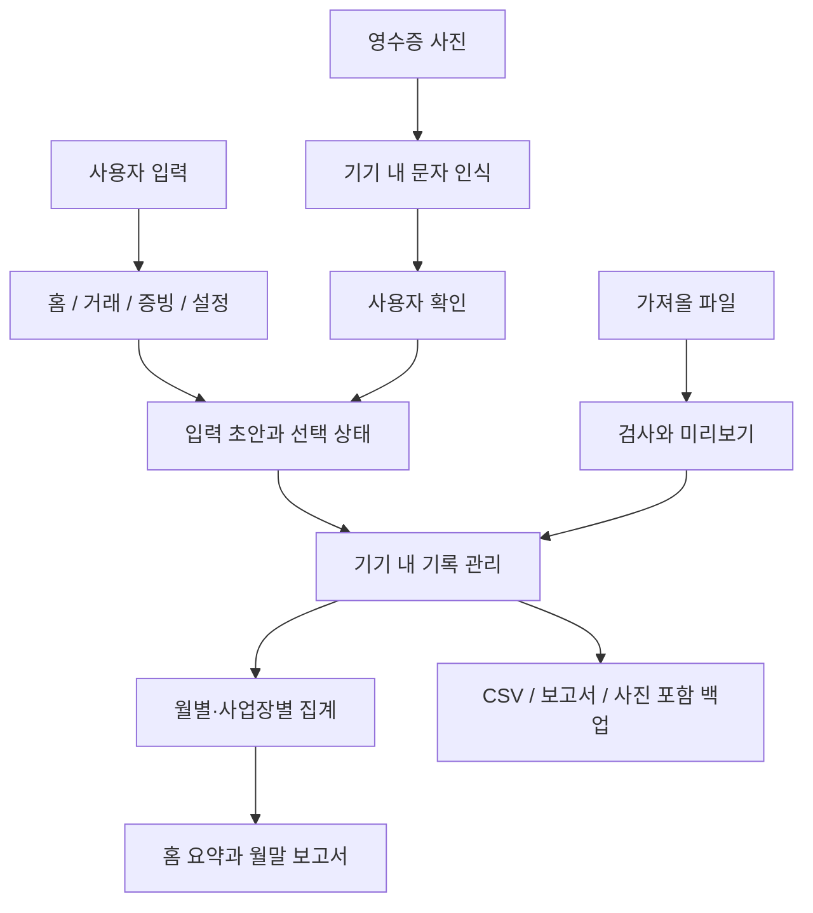

# 내세금관리 기술 구성

Kotlin과 Android Views로 구현한 네이티브 앱입니다. 실제 원본 코드의 역할을 설명하며, 공개 저장소에는 일부 UI 발췌와 학습 예제만 담았습니다.

도식은 역할을 요약한 것이며 서버 동기화나 별도의 클린 아키텍처 모듈을 의미하지 않습니다.

| 원본 파일 | 역할 | 공개 범위 |
|---|---|---|
| `LedgerActivity.kt` | 공통 화면, 입력 컨트롤, 상태·시스템 인셋 | 원리와 선택창 통합 예시 |
| `LedgerScreens.kt` | 홈·거래 입력·목록 화면 | 기능 설명·시연 이미지 |
| `LedgerSettings.kt` | 프로필·테마·알림 설정 | 기능 설명 |
| `LedgerTools.kt` | 계산 도구 화면 | 기능 설명 |
| `LedgerFiles.kt` | 증빙 연결·파일 가져오기·내보내기·백업 | 사용 흐름 설명 |
| `LedgerChoiceAdapter.kt` | 접힌 값과 펼친 행의 색상·레이아웃 분리 | 실제 UI 발췌 |

## 기술 선택

- **Kotlin:** 화면 이벤트와 데이터 처리 구현. 금액 학습 예제에서는 `Long`과 오버플로 검사를 사용합니다.
- **Views + Material Components:** 기존 앱의 구조를 이어가며 TextInputLayout·MaterialButton·Spinner·목록 대화상자를 개선했습니다. Compose 프로젝트로 소개하지 않습니다.
- **AndroidX:** Activity·AppCompat·Core 등을 사용해 화면과 시스템 영역의 동작을 다룹니다.
- **ML Kit:** 영수증 문자 인식을 기기에서 수행합니다. 결과는 사용자 확인 후 적용합니다.
- **JUnit + Android 계측 테스트:** 집계·파일 흐름과 실제 화면·입력·인셋·선택창을 나눠 검증했습니다.

## 입력 상태 처리

선택창은 목록에 원래 값이 없어도 기존 사용자 값을 보존해야 합니다. `choices + value`로 합쳐 중복을 제거하고, 저장된 값보다 현재 입력 중인 `draft`를 우선합니다. 화면이 다시 그려져도 테마 변경 때문에 선택 값이 사라지지 않도록 하는 것이 핵심입니다. [선택 상태 학습 예제](../examples/ChoiceSelectionExample.kt)

## 검증 기록

2026년 10월 28일, 원본 9.0.2 최종 빌드에서 단위 테스트 19개와 에뮬레이터 테스트 11개를 통과했습니다. 린트 오류는 0건이며 AAB 빌드와 업로드 키 서명을 검증했습니다. 선택창 검증에서는 밝은 화면·어두운 화면의 행 글자색, 팝업 배경 픽셀, 선택 인덱스, 날짜 버튼과 거래 검색 입력창을 확인했습니다.

해당 시점과 환경의 검증 기록이며 모든 Android 기기의 동작이나 측정하지 않은 성능 개선 수치를 주장하지 않습니다. 구매자·결제·Console 내부 화면은 공개하지 않습니다.
