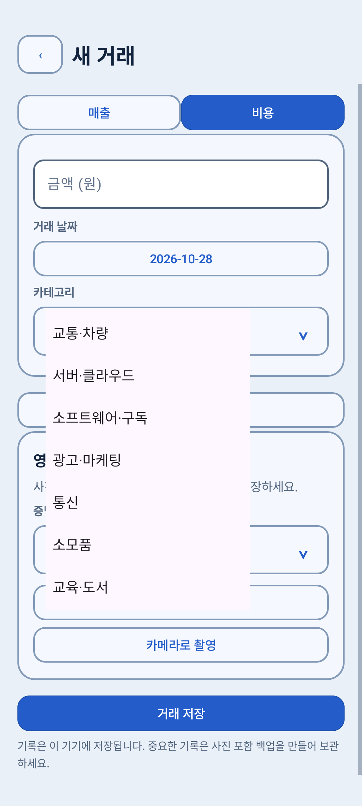
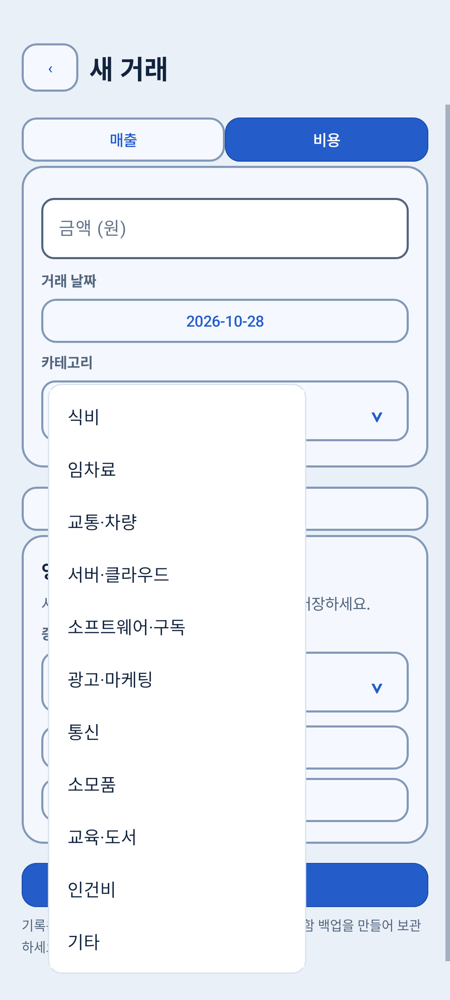
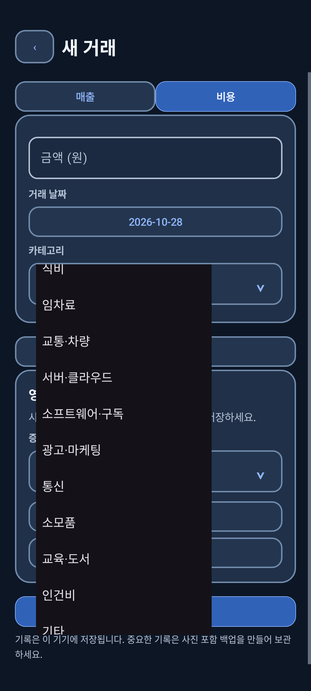
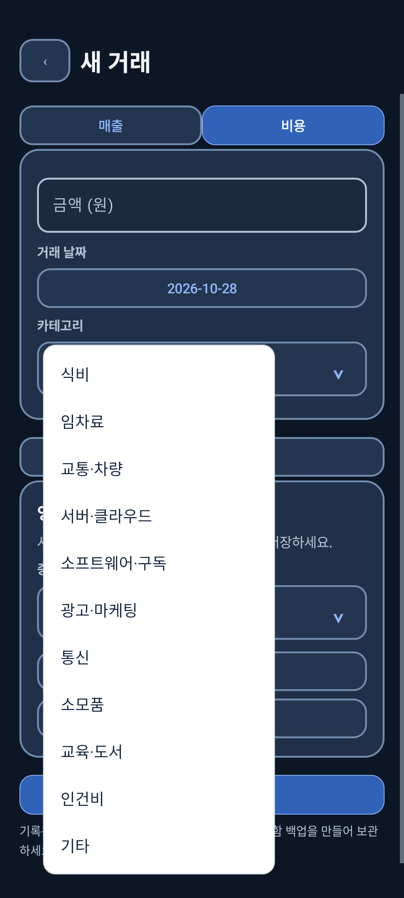

# 선택창과 하단 여백 개선 사례

## 1. 펼쳐진 목록의 기본 테마 색

기존 Spinner는 Activity의 테마와 Android 기본 목록 행을 사용했습니다. 목록 표면에 기본 테마 색이 남았고, 다크 모드에서는 어두운 목록이 표시됐습니다. 선택 목록은 흰색으로 통일하되 본문 화면의 라이트·다크 설정은 유지하도록 개선했습니다.

| 라이트 모드 변경 전 | 라이트 모드 변경 후 |
|---|---|
|  |  |

| 다크 모드 변경 전 | 다크 모드 변경 후 |
|---|---|
|  |  |

모든 화면은 테스트용 예시 데이터로 촬영했습니다.

### 네 층을 각각 지정하기

| 층 | 처리 |
|---|---|
| 선택창 Context | 선택창 전용 밝은 테마로 본문 다크 테마와 분리 |
| 접힌 값 | `getView()`에서 본문에 맞는 글자색 유지 |
| 펼친 행 | `getDropDownView()`에서 진한 남색 글자와 흰 ripple 배경 지정 |
| 팝업 바깥 면 | 흰 면·연한 테두리·둥근 모서리로 가장자리까지 처리 |

행 배경만 바꾸면 가장자리에 테마 색이 남고, 팝업만 흰색으로 바꾸면 다크 테마의 흰 글씨가 묻힐 수 있습니다. 실제 코드와 XML은 [android-ui](../examples/android-ui/)에 발췌했습니다. 13개 공통 함수 호출 지점에 같은 처리를 적용했고, 사업장·거래 작업·증빙 연결 등의 별도 목록창도 선택 전용 문맥을 사용했습니다.

## 2. 날짜 확인·취소 버튼 대비

날짜창을 흰색으로 바꾸는 과정에서 확인·취소 버튼의 흰 글씨가 상속되는 문제를 발견했습니다. 버튼 생성 이후 `setOnShowListener`에서 파란 글씨를 지정했습니다.

```kotlin
// 기존 DatePickerDialog 설정에 추가한 UI 처리 발췌
setOnShowListener {
    getButton(DatePickerDialog.BUTTON_POSITIVE)
        .setTextColor(Color.rgb(36, 93, 202))
    getButton(DatePickerDialog.BUTTON_NEGATIVE)
        .setTextColor(Color.rgb(36, 93, 202))
}
```

테스트에서는 버튼이 표시되고 폭·높이가 0보다 크며 글자색이 흰색이 아닌지 확인했습니다.

## 3. 하단 내비게이션 아래의 빈 공간

루트 화면과 하단 내비게이션이 시스템 하단 인셋을 함께 적용하면 같은 여백이 두 번 들어갈 수 있습니다. 주 화면에서는 하단 내비게이션이 시스템 영역을 한 번 담당하고, 키보드가 열렸을 때는 IME 인셋에 맞춰 분기하도록 정리했습니다. 상세 화면도 별도 처리가 필요합니다.

에뮬레이터에서 제스처·버튼 내비게이션과 키보드 조합을 검사했습니다. 제품 전체 화면 계층을 포함하지 않으므로 앱 구조에 종속된 인셋 코드는 그대로 복사할 수 있는 라이브러리로 소개하지 않습니다.

## 배운 점

테마 속성을 지정하는 것과 실제로 읽히는 화면을 만드는 것은 따로 확인해야 합니다. 목록이 열린 상태와 애니메이션 완료 이후 화면, 라이트·다크 모드, 버튼 가시성과 글자색을 함께 점검했습니다. 자동 검사와 시각 확인을 함께 사용했습니다.
